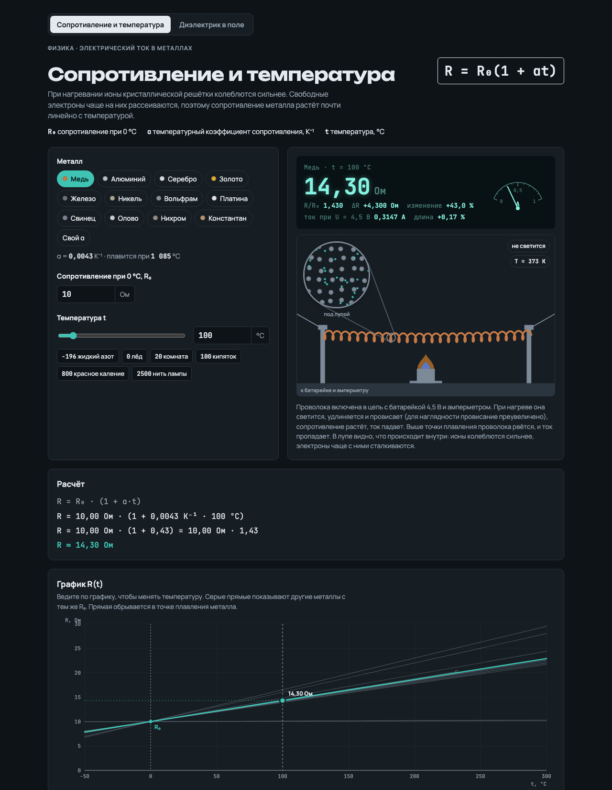
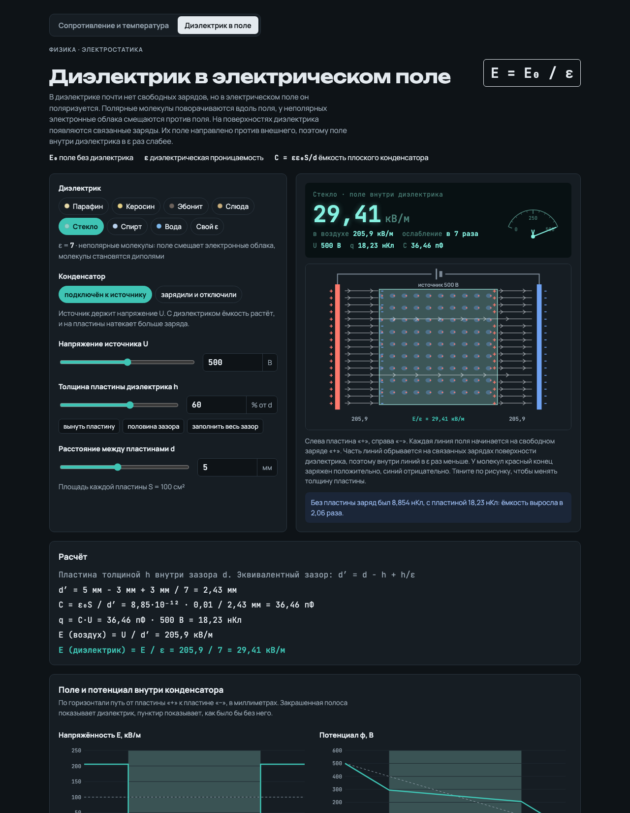

# Опыты по электричеству

Интерактивная страница для уроков физики: два виртуальных опыта, в которых можно менять вещество и условия и сразу видеть, что происходит с проводником или диэлектриком, а также числа и графики.

**Открыть:** https://fizika.130-49-141-77.sslip.io

Ссылки сразу на тему: [`#soprotivlenie`](https://fizika.130-49-141-77.sslip.io/#soprotivlenie) · [`#dielektrik`](https://fizika.130-49-141-77.sslip.io/#dielektrik)

## Сопротивление и температура: R = R₀(1 + αt)

- 12 металлов и сплавов (медь, алюминий, вольфрам, нихром, константан…) или свой коэффициент α.
- Проволока в цепи с батарейкой 4,5 В и амперметром: при нагреве горелкой она светится (от тёмно-красного до белого каления), удлиняется и провисает, ток падает. В жидком азоте покрывается инеем и стоит в кипящей ванне.
- Выше точки плавления проволока рвётся, капли падают на стол, ток пропадает.
- «Лупа» показывает решётку: ионы колеблются тем сильнее, чем выше температура, электроны чаще рассеиваются и дрейфуют медленнее.
- Пошаговый расчёт, график R(t) со всеми металлами (по нему можно водить мышью) и таблица сравнения.
- Предупреждает, где линейный закон перестаёт работать (сильное охлаждение, плавление).

## Диэлектрик в электрическом поле: E = E₀ / ε

- Плоский конденсатор с пластиной диэлектрика: парафин, керосин, эбонит, слюда, стекло, спирт, вода или своё ε.
- Толщину пластины можно менять ползунком или тянуть прямо по рисунку.
- Линии поля начинаются на свободных зарядах пластины; часть обрывается на связанных зарядах поверхности диэлектрика, поэтому внутри линий в ε раз меньше.
- Полярные молекулы (вода, спирт) поворачиваются вдоль поля, у неполярных смещаются электронные облака.
- Два режима: конденсатор подключён к источнику (растут заряд и ёмкость) или заряжен и отключён (падает напряжение — видно по электрометру).
- Расчёт C, q, U и полей, графики E(x) и φ(x) поперёк зазора, таблица всех веществ, предупреждение о пробое воздуха.

## Как устроено

- Один файл `index.html`: HTML, CSS и JavaScript без библиотек и сборщиков.
- Анимации на Canvas 2D, графики и стрелочные приборы на SVG.
- Светлая и тёмная тема по настройке системы, работает на телефоне, учитывает `prefers-reduced-motion`.
- Справочные значения α и ε взяты из школьных таблиц; модели упрощены для наглядности.

## Запуск

Открыть `index.html` в браузере, сервер не нужен.

Исходник страницы лежит в `src/index.html`, готовый файл собирается командой `./build.sh`.
